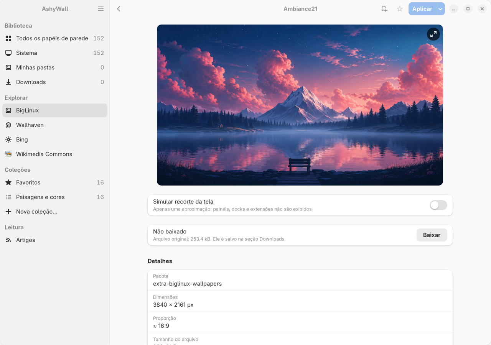

<p align="center">
  
</p>

# AshyWall

A wallpaper library for GNOME, built first for BigCommunity. AshyWall gathers
the wallpapers installed on the system and the images in folders you choose,
lets you preview them and applies them to the desktop.

**Development preview.** The interface currently supports English and
Brazilian Portuguese; the remaining 27 BigCommunity language targets are
pending. See [translation status](locale/README.md) and
[development and testing](CONTRIBUTING.md). Publishing the source does not
promote a package to BigCommunity's testing or stable repositories.

Version 1.1.0. Local library, preview and full-screen view, favorites,
collections, applying on GNOME, automatic change, and wallpapers from
BigLinux, Wallhaven, Bing and Wikimedia Commons, plus an optional RSS/Atom
reading list. See `CHANGELOG.md`.

<picture>
  <source media="(prefers-color-scheme: dark)" srcset="docs/screenshots/biglinux-wallpaper-dark.png">
  
</picture>

*BigLinux wallpaper preview. [More screenshots, including the system library,
collections and Reading](docs/screenshots/README.md).*

## Features

- **System wallpapers** discovered from GNOME background catalogs
  (`gnome-background-properties/*.xml`, including dark variants) and the
  shared `backgrounds`/`wallpapers` folders of every XDG data directory.
- **Personal folders** added explicitly by the user. Files are only read;
  removing a folder from the library never touches the disk. The home
  directory is never scanned on its own.
- **Gallery** with virtualized grid, asynchronous thumbnails (disk cache with
  a size limit), search and compact filters for orientation and resolution.
  Rows are read only as they scroll into view and queries run off the main
  loop, so a library of 100,000 images responds like a small one (measured:
  sections and searches answer in under 0.3 s without freezing the window).
- **Detail page** with a large preview, real pixel dimensions, aspect ratio,
  file size, format, source (including the owning package for system files),
  location and byte-identical copies found in the library.
- **Full-screen view** of the file at full resolution: as the desktop would
  show it, the whole image, or at actual size (one image pixel per screen
  pixel, with panning). Double-click toggles actual size at the clicked point.
- **Screen crop simulation** for the current monitor, clearly labelled as an
  approximation.
- **Apply** to the light style, the dark style or both, with undo and
  "restore previous wallpaper".
- **Automatic change** through GNOME's own slideshow format: pick a section
  or collection, an interval (5 minutes to a day), shuffle, a minimum
  resolution and whether to skip portrait images. GNOME switches the picture
  with a cross-fade, so AshyWall does not need to keep running, even after a
  restart. The list is updated when the library changes without changing
  the picture on screen; turning it off keeps the current picture.
- **Favorites** stored by origin and identifier, so they survive re-indexing;
  online favorites keep their listing and show up without a connection.
- **Collections** created by the user, mixing local and online wallpapers.
  Deleting a collection never touches the wallpapers in it.
- **Optional Reading section**, enabled in Preferences → Reading. Add your
  own RSS 2 or Atom feeds, organize sources by topic, search cached titles
  and sources, and mark articles as read or unread. A quiet, virtualized
  text list uses the same GTK/libadwaita navigation as the wallpaper library,
  adapting to narrow windows and the system's light/dark style. Summaries
  are plain text; full articles open in the default browser.
  Sources update only when explicitly added or refreshed: no startup
  requests, background polling, notifications or embedded article images.
  Cached articles remain available offline. Up to 50 public HTTPS sources
  are supported, with 500 recent articles retained per source, 60 items per
  page and a 2 MB limit per feed. DTDs, XML entities and private network
  destinations are rejected. Direct connections use validated public DNS
  addresses; a user-configured HTTPS proxy is trusted to route public hosts.
- **BigLinux wallpapers**: the remade collection of the
  `biglinux-wallpapers-base` and `extra-biglinux-wallpapers` packages, read
  from their GitHub repositories (about 400 AVIF images in 4K). The file
  list is kept for a day and each image's size, read from the first bytes
  of the file, for as long as the file does not change. Both packages
  declare the GPL in their PKGBUILD, which AshyWall shows and links to.
- **Wallhaven** browsing (search, sorting, orientation and resolution
  filters, endless scrolling). Searches are sorted by relevance unless you
  pick another order; "top this month" only covers the last month's ranking.
  Safe-for-work content only, no account or API key. Nothing is contacted
  until you open the Wallhaven section.
- **Bing image of the day** for about the last two weeks, with its caption
  and photographer credit. Bing publishes no license; AshyWall says so. The
  real size of each UHD original is read from its first bytes before it is
  listed.
- **Wikimedia Commons picture of the day**, 30 days per page back to 2004,
  each with its author and license (Creative Commons or public domain),
  which are also recorded with downloads. Only this curated selection is
  browsed: Commons has no safe-search filter, so free-text search over all
  of it is not offered.
- **Full-resolution previews** of online wallpapers: opening one fetches the
  original into a pruned cache (600 MB) after showing the provider's
  thumbnail. Originals above 15 MB and metered connections wait for a click.
  Downloading a previewed wallpaper reuses the cached file, checked again.
- **Downloads** on demand with progress and cancellation. Files are verified
  (format, pixel limits, dimensions announced by the provider) before they
  are moved into place, never overwrite an existing file and appear in the
  Downloads section with their uploader, original source and provider page.

### Resolution criteria

Filters compare the long side with the long side and the short side with the
short side, in either orientation:

| Filter  | Long side | Short side |
|---------|-----------|------------|
| Full HD | ≥ 1920    | ≥ 1080     |
| QHD     | ≥ 2560    | ≥ 1440     |
| 4K      | ≥ 3840    | ≥ 2160     |
| 8K      | ≥ 7680    | ≥ 4320     |

Pixel size says nothing about whether an image was upscaled, and AshyWall does
not claim it does.

Wallhaven's own `atleast` filter compares width and height literally. With
"any orientation", AshyWall asks Wallhaven for both sides to be at least the
tier's short side and applies the long-side rule itself, so pages can hold
fewer than 24 results and the total count is not shown.

## Requirements

- Python ≥ 3.12, PyGObject
- GTK ≥ 4.16 and libadwaita ≥ 1.6 (developed and tested with GTK 4.22 and libadwaita 1.9)
- Pillow ≥ 11.3 (AVIF support)
- defusedxml ≥ 0.7.1 (safe RSS/Atom parsing)
- GNOME with `gsettings-desktop-schemas` to apply wallpapers

## Running from source

```sh
./scripts/run-dev.sh
```

## Tests

See [CONTRIBUTING.md](CONTRIBUTING.md) for the `dev-xathay` workflow, complete
local validation and the separate BigCommunity testing-package stage.

```sh
python -m pytest
```

Desktop tests use an in-memory GSettings backend and never change the running
session's wallpaper.

## Packaging

`pkgbuild/PKGBUILD` builds a wheel with `uv_build` and installs it with
`python-installer`. Files under `usr/` (desktop entry, AppStream metainfo,
icon, translations, licenses) are installed to `/usr`.

To update an existing Arch/BigCommunity installation from this checkout,
close AshyWall and run:

```sh
./scripts/build-local-package.sh -si
```

The helper builds the current committed source, including local commits not
pushed upstream. It verifies the source archive, runs the test suite and
leaves packages in `dist/packages/`; `-si` installs dependencies if needed
and updates AshyWall through pacman. Commit source changes first so the
package always corresponds to a reviewable Git snapshot. Use the helper
without `-si` to build without installing anything.

## Translations

The release target is the 29-language set used by BigCommunity's LangForge,
including English source. Current coverage and the mandatory release check
are documented in [locale/README.md](locale/README.md).

User-facing strings are in English in the code and translated with gettext
(`locale/*.po`). After changing strings, run:

```sh
./scripts/update-translations.sh
```

## Known limitations

- GNOME uses a single picture per style for every monitor; per-monitor
  wallpapers are not supported.
- The automatic change uses local files only. Online favorites and
  collection items join it once downloaded, and new files join the next time
  AshyWall opens (or refreshes the library); nothing fetches new online
  pictures in the background.
- Applying from a Flatpak sandbox (wallpaper portal) is not implemented.
- Formats decoded: JPEG, PNG, WebP, AVIF, TIFF and BMP. JPEG XL and HEIF
  wallpapers are not listed yet.
- Author and license are shown only when the source provides them. For a
  system wallpaper installed by a package, the license is the one that
  package declares (with the license text it installed); other local files
  show none. Wallhaven names the uploader (not necessarily the author) and
  Bing the photographer; neither publishes a license, and AshyWall says so on
  each page. Wikimedia Commons gives author and license. AshyWall reports
  what each source declares and does not grant or verify rights itself.
- Images above 80 megapixels (far beyond 8K) are shown reduced in the
  full-screen view, and the view says so.
- The online services may change without notice; AshyWall validates every
  response and shows an error instead of partial data. Wikimedia limits how
  many originals one address may download in a short time; when that
  happens AshyWall asks you to wait a minute.

## License

MIT. The owl in the application icon is adapted from the
[AshyTerm](https://github.com/big-comm/ashyterm) icon (MIT, © 2024 Community
Big); its license is installed as
`/usr/share/licenses/ashywall/LICENSE.ashyterm-icon`. The icon is provisional.
