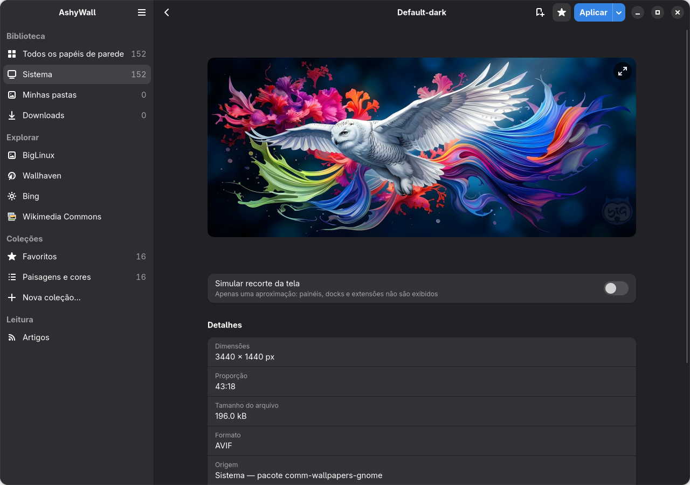
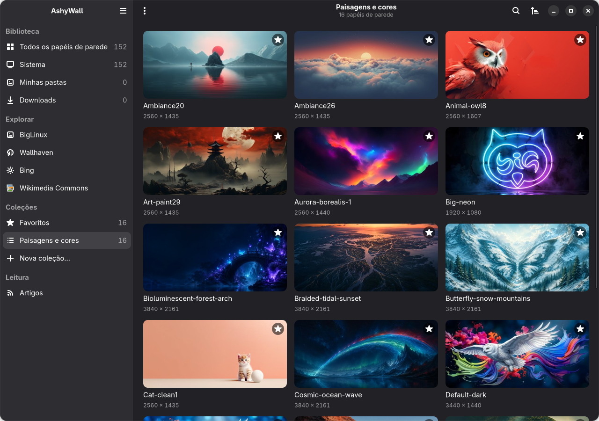
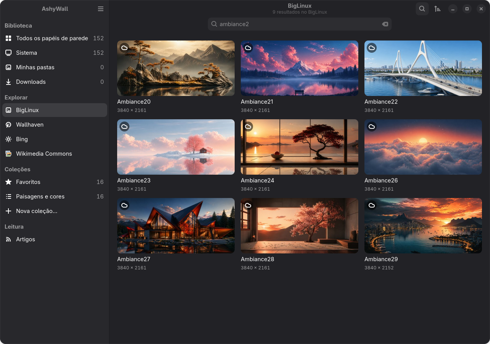
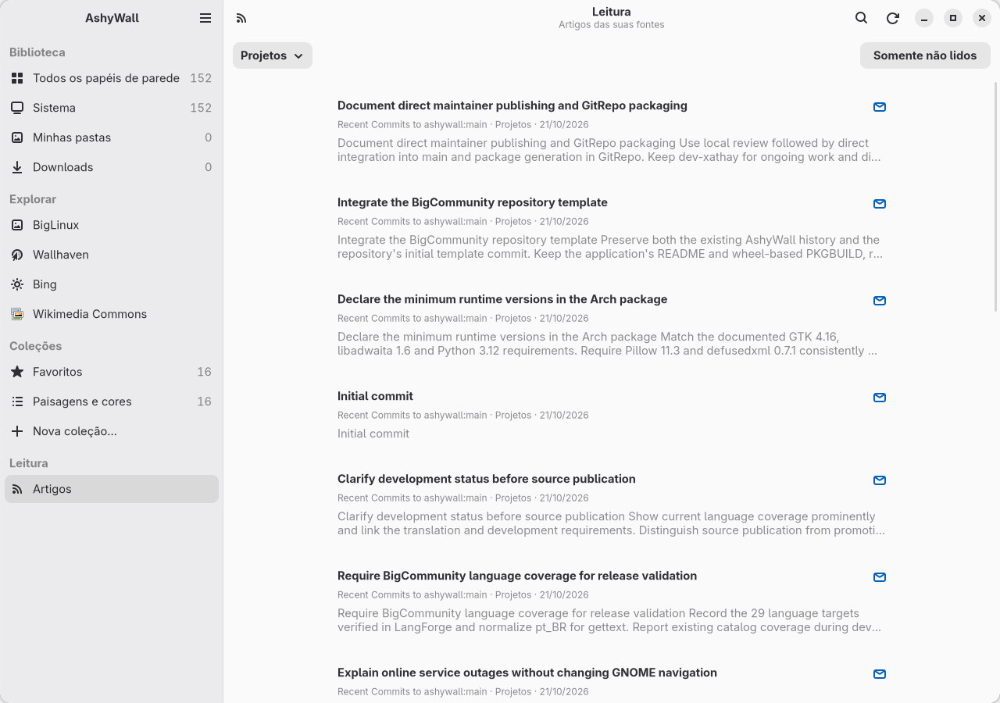

# AshyWall screenshots

Real captures of AshyWall 1.1.0 on GNOME, with its GTK 4/libadwaita
interface in Brazilian Portuguese. Captured on 2026-10-21 at 1280 × 900,
using a separate application profile and a private session bus. The
interface and wallpaper artwork are unmodified.

The demonstration collection contains 16 selected system wallpapers;
library and collection counts come from that isolated catalog. No personal
library, desktop contents, credentials or private feeds are included.

## System wallpaper

The installed `Default-dark` wallpaper, featuring the BigCommunity owl.

## Collections

A curated collection of wallpapers already installed on the system.

## BigLinux gallery

Live BigLinux results for the filename search `ambiance2`.

## BigLinux preview

`Ambiance21`: mountains, a lake and a pink sky. The preview below follows
the theme used to view this page; both light and dark captures are included.

<picture>
  <source media="(prefers-color-scheme: dark)" srcset="biglinux-wallpaper-dark.png">
  
</picture>

## Optional Reading

The project's own public GitHub Atom feed, filtered by the demonstration
topic `Projetos`. These are actual published commit entries, not sample
headlines or invented articles. Reading remains optional.

<picture>
  <source media="(prefers-color-scheme: dark)" srcset="reading-dark.png">
  
</picture>

## Sources and credits

- System wallpapers: the installed
  [`comm-wallpapers-gnome`](https://github.com/big-comm/comm-wallpapers-gnome)
  package, version `26.09.20-2128`. Its metadata and
  [license](https://github.com/big-comm/comm-wallpapers-gnome/blob/main/LICENSE)
  declare MIT, copyright 2024 Community Big.
- Selected online wallpaper: `usr/share/wallpapers/ambiance21.heic` in
  [`biglinux/extra-biglinux-wallpapers`](https://github.com/biglinux/extra-biglinux-wallpapers/blob/b1fe70c28d61b67134e390d1053b1d2e9088d628/usr/share/wallpapers/ambiance21.heic),
  revision `b1fe70c28d61b67134e390d1053b1d2e9088d628`. The package
  [declares GPL](https://github.com/biglinux/extra-biglinux-wallpapers/blob/b1fe70c28d61b67134e390d1053b1d2e9088d628/pkgbuild/PKGBUILD).
- Reading source: the public
  [AshyWall main-branch Atom feed](https://github.com/big-comm/ashywall/commits/main.atom).
- Application interface: AshyWall, under the project's [MIT license](../../LICENSE).

Wallpaper credits and the licenses declared by their source packages
remain separate from the application UI license. Original wallpaper files
are not bundled in this directory; the PNGs show them inside the application.
